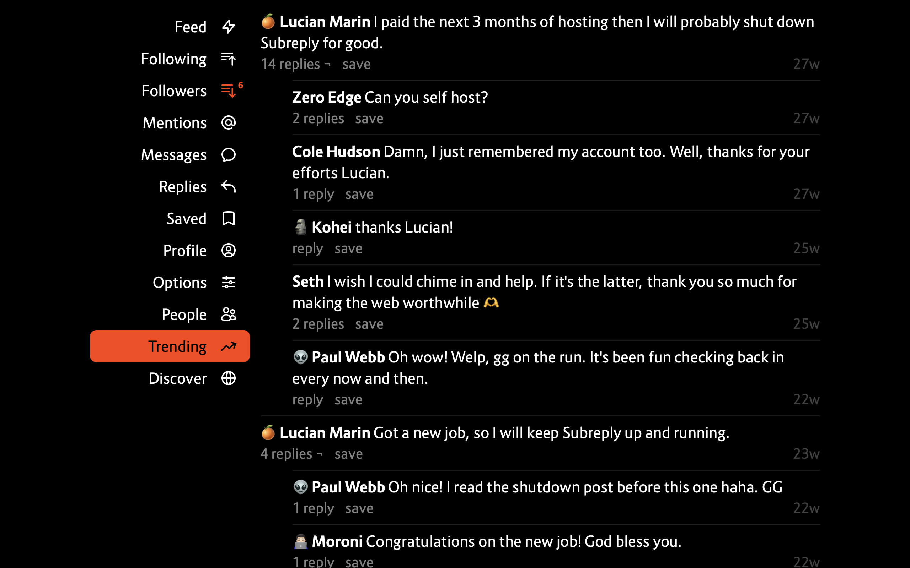

# Subreply



Tiny, but mighty social network. Create an account at https://subreply.com.

## Install

Install PostgreSQL server at 6432 port and `createdb subreply` then:

```shell
pip3 install -r requirements.txt
python3 manage.py migrate
```

Create `project/local.py` file and generate `SIGNATURE` for it:

```python
from cryptography.fernet import Fernet
SIGNATURE = Fernet.generate_key()
```

Launch the app at http://localhost:8000 with:

```shell
gunicorn main:app
```

## Styleguide

- easy to read and easy to modify
- no useless abstractions
- speed of 50ms or lower for each request


## License

- ideal to use as internal social network in any organization
- easy to install and easy to maintain
- cost depends on level of support needed


## Architecture

Why Falcon + Gunicorn + Django ORM + PgBouncer over FastAPI + Tortoise ORM:

- single-query composition with Django ORM (`OuterRef`, `ArraySubquery`, inline `Subquery`) avoids multiple database round-trips required by Tortoise ORM
- PgBouncer handles connection pooling at port 6432 with sub-millisecond local I/O, making async database drivers unnecessary
- Falcon WSGI + Gunicorn has lower per-request framework and serialization overhead than FastAPI/Pydantic
- CPU-bound PBKDF2 hashing, Jinja2 rendering, and synchronous DNS MX lookups run in isolated workers without blocking an async event loop

